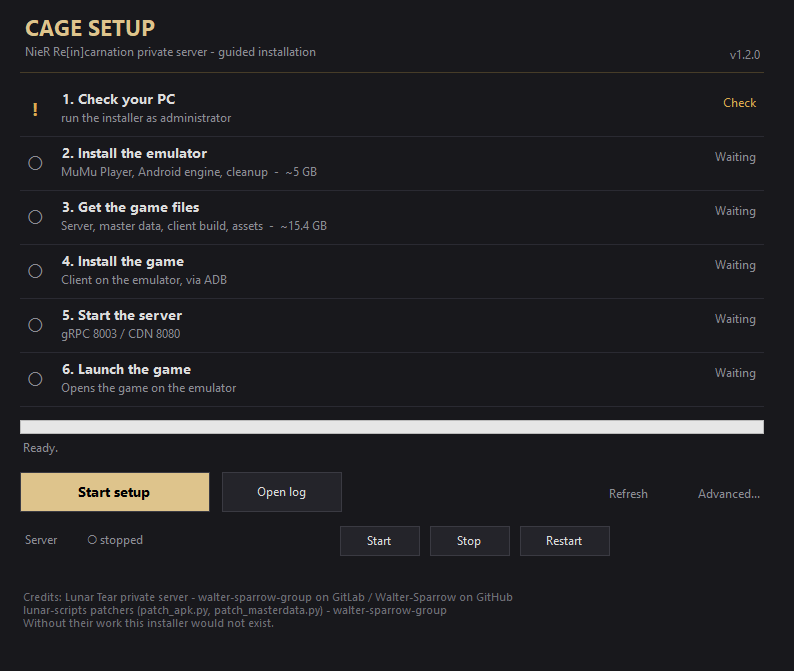

# Cage Setup

An unofficial Windows installer for the **NieR Re[in]carnation** private server ([Lunar Tear](https://gitlab.com/walter-sparrow-group/lunar-tear), mirrored on [GitHub](https://github.com/Walter-Sparrow/lunar-tear)).

Double-click **`CageSetup.exe`**, press **Start setup**, and it downloads, installs and configures MuMu Player, the server, the game data and the patched client. Every download shows progress, speed and time left.



> This repository contains **no game APK, no game assets and no master data**. Everything is downloaded at runtime from its original host.

## Why this exists

Setting up the server by hand means installing an emulator, finding a compatible APK, patching it, downloading about 15 GB of assets, patching the master data and starting three services in the right order. I wrote those steps down more than once, then turned the notes into this installer so that the next person does not have to.

It is a wrapper around the work of the Lunar Tear and lunar-scripts projects. The installer does not reimplement the server or the patchers: it downloads them, pins them by hash, and runs them in order.

## Requirements

- Windows 10 or 11, 64-bit
- Virtualization (VT-x / AMD-V) enabled in the BIOS, Hyper-V disabled
- Administrator rights, for the MuMu Player installation
- About 25 GB free (75 GB with the full game assets), on the drive that holds the game files
- A connection: the downloads are about 20 GB

Step 1 checks these at startup.

## Usage

1. Download **`CageSetup.exe`** from [Releases](https://github.com/claitt/cage-setup/releases), or [build it yourself](#the-executable), and put it in a writable folder.
2. Run it and accept the UAC prompt.
3. Press **Start setup**. Finished steps are skipped, so pressing it again after a failure is safe.
4. When the button becomes **Launch game**, the server is running: click it.

Everything lives in the game files folder, next to the executable by default. Copy the folder to move it, delete it to start over.

**Use game files...** points the installer at a folder you already have and reuses what it finds there. Only what is still missing gets downloaded: a folder with a patched client, for example, needs neither the stock APK nor the build toolchain.

While setup runs, the primary button becomes **Cancel setup**: it stops the current step and keeps `.part` files for resume. Enter activates the primary button; Esc cancels a running setup or closes the window.

**Open log** opens `installer-log.txt`. **Copy diagnostics** puts version, Windows build, component states and the last log lines on the clipboard. **Refresh** re-checks the steps. **Advanced...** runs a single component; **Start / Stop / Restart** control the server.

## Known issues and limitations

I would rather list these than pretend they do not exist.

- **Not tested on a clean Windows install yet.** I have run it on Windows 11 23H2 with MuMu 6.8.5. A clean-VM matrix is still an open issue.
- **Local builds are not byte-identical to the CI build.** The source and the ps2exe command are the same, but the executable embeds a build timestamp, so the SHA256 differs between machines. Check the published `.sha256` for the file you downloaded, or verify the attestation.
- **The first status check takes about 7 seconds.** Each ADB probe costs about a second and the closed server ports add more. The window stays responsive, but the steps update slowly the first time.
- **APKMirror sometimes refuses the connection.** The stock APK can be downloaded manually and dropped into `apk\stock\`; the installer picks it up.
- **MuMu windows cannot be re-shown from another process.** If the hidden installation stalls, the installer kills it and retries with the window visible.
- **No code signing.** SmartScreen will warn. The build is attested and the hash is published.

## The executable

`CageSetup.exe` is the PowerShell sources in this repository packed into one executable with [ps2exe](https://github.com/MScholtes/PS2EXE). `build.ps1` inlines `lib\*.ps1` into a temporary single script and hands it to ps2exe; the embedded manifest asks for administrator rights.

Build it yourself (PowerShell 5.1):

```powershell
Install-Module ps2exe -Scope CurrentUser
.\build.ps1 -Pack
```

The workflow runs the same command and publishes the result. Every release has a build provenance attestation:

```powershell
gh attestation verify CageSetup.exe --repo claitt/cage-setup
```

`CageSetup.exe.sha256` contains the SHA256 of the published file. You can also run the sources directly:

```powershell
powershell -NoProfile -ExecutionPolicy Bypass -File "Cage Setup.ps1"
```

It behaves like the executable; only the icon differs and it does not elevate itself.

## Where the files come from

| Resource | Host | Size |
|---|---|---|
| Server binaries | GitHub Releases (Lunar Tear, pinned, SHA256) | ~33 MB |
| Game assets | archive.org (nier_reincarnation_assets) | 14.93 GB (~48.8 GB extracted) |
| Master data | archive.org (20240404193219.bin) | 7.4 MB (patched locally) |
| Game client (APK) | APKMirror (NieR Re[in]carnation 3.7.1) | 251 MB (patched locally) |
| Patcher scripts | lunar-scripts (pinned commit) | ~64 KB |
| MuMu Player | official NetEase download (signature-checked) | ~5 GB with engine |
| Toolchain | Adoptium, Apktool, Android build tools, python.org, PyPI | ~140 MB |

Downloads are resumable (`.part` files). Every file is checked against a pinned size and hash before it is unpacked or executed: SHA256 for the toolchain and the stock APK, SHA1 where the host publishes only that.

## Development

```powershell
# lint (main script and modules)
Invoke-ScriptAnalyzer -Path 'Cage Setup.ps1' -Settings PSScriptAnalyzerSettings.psd1
Invoke-ScriptAnalyzer -Path lib -Settings PSScriptAnalyzerSettings.psd1 -Recurse

# tests (Pester 5.7)
Invoke-Pester -Path tests -Output Detailed

# bundle, and optionally pack the executable
.\build.ps1
.\build.ps1 -Pack

# diagnostics, no GUI
powershell -ExecutionPolicy Bypass -File "Cage Setup.ps1" -Console
```

The tests load the modules directly. The workflow lints both the main script and `lib\`, runs the tests, builds the executable and smoke-tests it. See [CONTRIBUTING.md](CONTRIBUTING.md) and [SECURITY.md](SECURITY.md).

## Troubleshooting

**SmartScreen or antivirus flags the file.** The executable is not code-signed. Compare its SHA256 with the published one, [build it yourself](#the-executable), or run `Cage Setup.ps1` directly.

**The executable does not start.** Accept the UAC prompt; administrator rights are needed for MuMu. For the actual error, run `Cage Setup.ps1` directly.

**The MuMu installer signature warning.** Its Authenticode signature must be from NetEase. Answer **No** unless the file comes from the official source.

**The asset download is huge.** 14.93 GB compressed, about 48.8 GB extracted. Free space is checked before downloading and before extracting, and the transfer resumes if interrupted.

**Client build fails.** The log names the failing tool. Common causes: missing `curl.exe` (Windows older than 10 1803), an APKMirror outage, or an updated `patch_apk.py`. Delete `apk\out\nier-patched.apk` to rebuild.

**APKMirror refuses the connection.** Download the APK manually, save it as `apk\stock\nier-3.7.1-stock.apk` and press the button again.

**Emulator step stuck on "Waiting".** Press **Start setup** (or **Launch game**); the step turns green once debloat, client and ARM bridge are verified.

## License

The installer code is released under the [MIT License](LICENSE). This covers this repository only: NieR Re[in]carnation and its assets belong to Square Enix; the Lunar Tear server and lunar-scripts patchers remain their own projects. No game content is distributed here. This project is not affiliated with Square Enix, NetEase or Lunar Tear.

## Credits

- **Lunar Tear** private server - [walter-sparrow-group on GitLab](https://gitlab.com/walter-sparrow-group/lunar-tear) / [Walter-Sparrow on GitHub](https://github.com/Walter-Sparrow/lunar-tear)
- **lunar-scripts** patchers (`patch_apk.py`, `patch_masterdata.py`) - [walter-sparrow-group](https://gitlab.com/walter-sparrow-group/lunar-scripts)

Without their work this installer would not exist.
