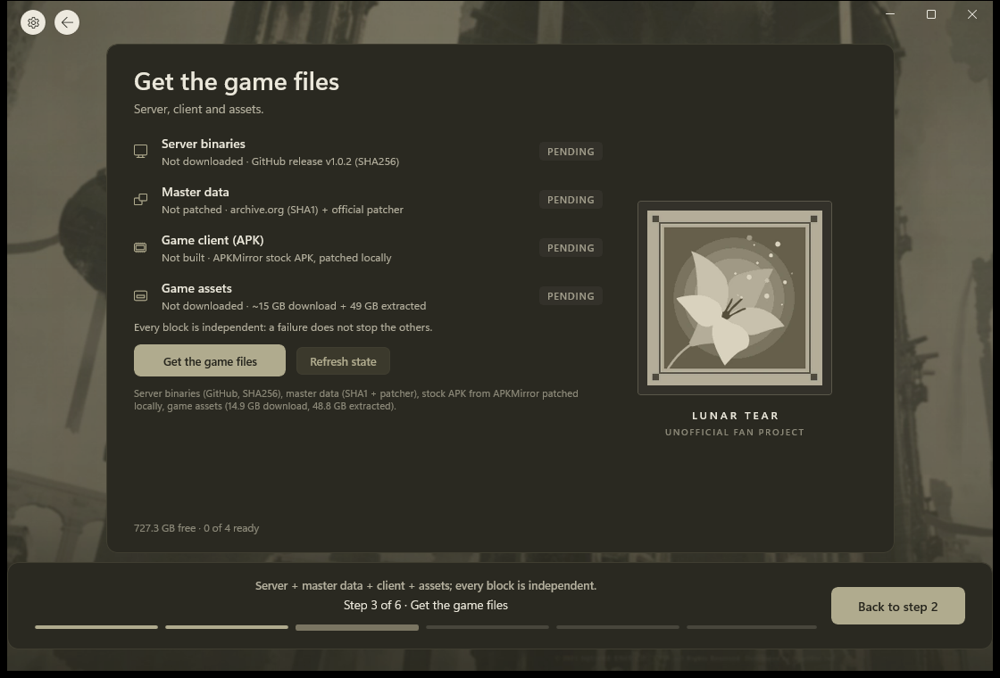

# The Cage Setup

Unofficial Windows setup for NieR Reincarnation, through the Lunar Tear private server. It installs MuMu Player, the game files and the client, then starts the server and launches the game.



[](https://ko-fi.com/claitt)

## Download

1. Open the [latest release](https://github.com/claitt/the-cage-setup/releases/latest).
2. Under Assets, download `CageSetup2-2.0.0-win-x64.exe`.
3. Put it in a folder it can keep using, then run it. Nothing to install: game files and server data are created next to the executable.

The build is not code-signed, so Windows SmartScreen shows an unknown-publisher warning. Choose "More info", then "Run anyway".

## Requirements

- Windows 11, x64, administrator rights
- Virtualization enabled in firmware
- About 65 GB free for the game assets (15 GB download, 49 GB extracted)

## Build

```powershell
powershell -ExecutionPolicy Bypass -File .\build-winui.ps1
```

The output is a single self-contained executable in `dist\CageSetup2\`.

## Tests

```powershell
dotnet test CageSetup.Tests\CageSetup.Tests.csproj -c Release -p:Platform=x64
```

## Credits

- [Lunar Tear](https://github.com/Walter-Sparrow/lunar-tear): the private server.
- [lunar-scripts](https://gitlab.com/walter-sparrow-group/lunar-scripts): the patchers used for master data and client.

## Stack

WinUI 3 (Windows App SDK), .NET 9.

## Legacy

The previous PowerShell installer is preserved on the `legacy/1.x` branch.

## License

MIT. See [LICENSE](LICENSE).
